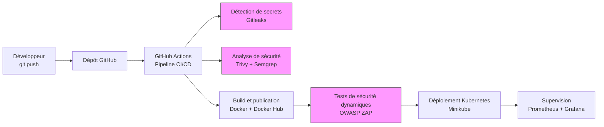

# 🛒 ShopSecure — Pipeline DevSecOps pour une boutique e-commerce

## 📖 Présentation

**ShopSecure** est un projet pédagogique qui illustre la mise en place d’une chaîne de livraison logicielle sécurisée (**DevSecOps**) autour d’une application e-commerce développée avec **React** et **Nginx**, et destinée à être déployée sur **Kubernetes**.

L’objectif est d’automatiser les principales étapes du cycle de livraison logicielle : analyse du code, détection des vulnérabilités, construction de l’image Docker, tests de sécurité et déploiement. Des contrôles de sécurité sont intégrés au pipeline CI/CD afin d’identifier les risques avant la mise en production.

## 🏗️ Architecture

## 🔐 Étapes du pipeline DevSecOps

| Étape | Outil(s) | Description |
|---|---|---|
| Intégration continue | GitHub Actions | Automatise l’exécution des différentes étapes du pipeline. |
| Détection de secrets | Gitleaks | Recherche les secrets potentiellement exposés dans le dépôt Git. |
| Analyse des vulnérabilités | Trivy | Analyse les images conteneurisées et les dépendances prises en charge afin d’identifier les vulnérabilités. |
| Analyse statique du code | Semgrep | Détecte des problèmes de sécurité et des motifs de code potentiellement dangereux. |
| Construction de l’image | Docker | Génère une image conteneurisée de l’application. |
| Publication de l’image | Docker Hub | Héberge l’image Docker afin de permettre sa distribution. |
| Tests de sécurité dynamiques | OWASP ZAP | Analyse l’application en fonctionnement pour rechercher des vulnérabilités web. |
| Déploiement | Kubernetes, Minikube | Permet de déployer et d’exécuter l’application dans un environnement Kubernetes local. |
| Supervision | Prometheus, Grafana | Permet de collecter et de visualiser des métriques de supervision, selon la configuration mise en place. |

## 🧰 Technologies utilisées

- **Frontend :** React
- **Serveur web :** Nginx
- **CI/CD :** GitHub Actions
- **Conteneurisation :** Docker
- **Registre d’images :** Docker Hub
- **Détection de secrets :** Gitleaks
- **Analyse de sécurité :** Trivy, Semgrep
- **Tests dynamiques :** OWASP ZAP
- **Orchestration :** Kubernetes, Minikube
- **Monitoring :** Prometheus, Grafana

## 🎯 Objectifs du projet

- Mettre en place un pipeline CI/CD automatisé.
- Intégrer des contrôles de sécurité dès les premières étapes du développement.
- Détecter les secrets exposés dans le code source.
- Identifier les vulnérabilités potentielles du code, des dépendances et des images Docker.
- Automatiser la construction et la publication des images conteneurisées.
- Effectuer des tests de sécurité dynamiques sur l’application.
- Déployer l’application sur un cluster Kubernetes local.
- Préparer la supervision de l’environnement à l’aide de Prometheus et Grafana.

## 📋 Prérequis

Les outils suivants sont nécessaires pour reproduire l’environnement, selon les étapes que tu souhaites exécuter :

- Git
- Docker
- Node.js et npm
- Un compte GitHub
- Un compte Docker Hub
- Minikube
- kubectl

Les outils de sécurité et de supervision doivent également être installés ou configurés dans le pipeline et dans l’environnement de déploiement.

## 🚀 Vue d’ensemble du fonctionnement

1. Le développeur apporte des modifications au code et les pousse vers le dépôt GitHub.
2. GitHub Actions déclenche le pipeline CI/CD.
3. Gitleaks recherche les secrets potentiellement exposés.
4. Trivy et Semgrep effectuent les analyses de sécurité configurées.
5. Docker construit l’image de l’application et la publie sur Docker Hub si les étapes précédentes et les conditions du pipeline le permettent.
6. OWASP ZAP effectue les tests dynamiques sur une application accessible dans l’environnement de test prévu.
7. L’application est déployée sur Kubernetes à l’aide de Minikube.
8. Prometheus et Grafana peuvent être utilisés pour la supervision lorsque leur configuration est opérationnelle.

## 🛡️ Sécurité du pipeline

L’approche DevSecOps vise à intégrer la sécurité au cycle de développement plutôt qu’à la traiter uniquement à la fin du projet.

Les contrôles peuvent être configurés pour interrompre le pipeline lorsqu’un secret est détecté ou lorsqu’une vulnérabilité répond à des critères de blocage définis.

**Important :** la détection d’un problème ne bloque pas automatiquement une livraison. Ce comportement dépend des règles, des seuils et des conditions configurés dans les workflows GitHub Actions.

## 📌 État du projet

Ce dépôt présente l’architecture et les objectifs du projet ShopSecure. Les étapes réellement opérationnelles dépendent des fichiers de configuration, des workflows CI/CD et des manifestes Kubernetes présents dans le dépôt.

Les fonctionnalités de build, de scan, de déploiement et de supervision doivent être vérifiées dans l’environnement avant d’être considérées comme opérationnelles.

## 📄 Licence

Aucune licence n’est spécifiée dans cette documentation. Si le projet doit être distribué publiquement, ajoute un fichier `LICENSE` correspondant à la licence choisie.